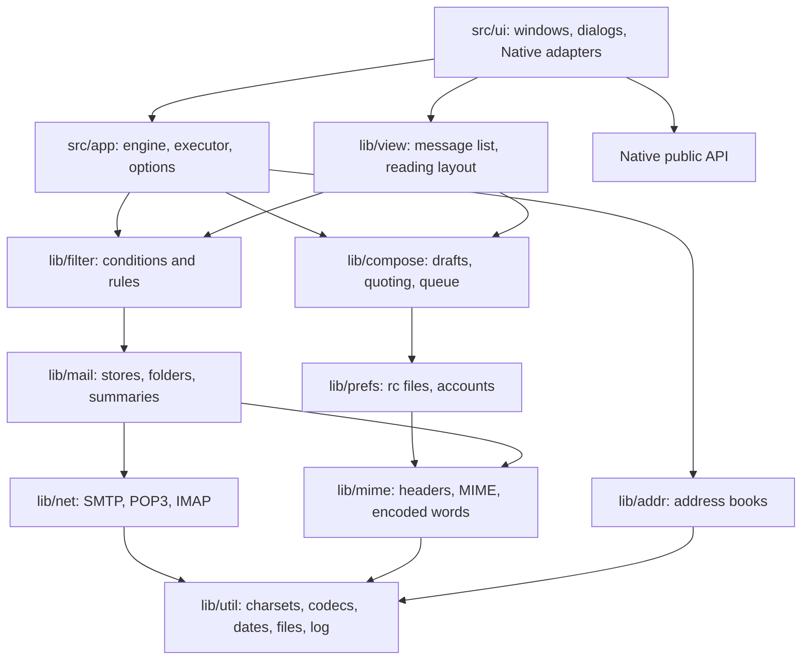

# Blaise architecture

Blaise is Claws Mail rebuilt from the ground up on the Native UI library. It keeps
Claws' on-disk formats and the ideas that make Claws work. It replaces the C code,
GLib, GTK, GnuTLS and libetpan with modern C++20 and one UI layer.

This records the decisions and why they were made. Port coverage is in
[notes/PORT-STATUS.md](notes/PORT-STATUS.md).

## Layers

Dependencies point downward only. Everything except `src/ui/` builds and tests
without a display.

| Library | Claws origin | Holds |
| --- | --- | --- |
| `lib/util` | `common/utils`, `codeconv`, `quoted-printable`, `md5`, `file-utils`, `log`, `xml` | Text, charsets, Base64, QP, MD5, dates, atomic files, the session log, XML |
| `lib/mime` | `procheader`, `procmime`, `unmime`, `html`, `enriched`, `compose` writing | Headers, addresses, encoded words, MIME trees, HTML to text, rendering |
| `lib/prefs` | `prefs_gtk`, `prefs_account`, `account`, `prefs_common` | The rc format, accounts, passwords, preferences |
| `lib/net` | `common/socket`, `ssl`, `session`, `smtp`, `pop`, `etpan/imap-thread` | Transports, TLS, the three mail protocols |
| `lib/mail` | `folder`, `mh`, `imap`, `msgcache`, `procmsg`, `mbox` | The store interface, MH, IMAP, Claws' cache formats, mbox, `folderlist.xml` |
| `lib/filter` | `matcher`, `filtering`, `advsearch` | Conditions, rules, `matcherrc`, quick search |
| `lib/addr` | `addrbook`, `addritem`, `addrindex`, `addr_compl`, `ldif`, `vcard` | Address books, completion, LDIF, vCard |
| `lib/compose` | `compose`, `quote_fmt`, `procmsg` queueing | Drafts, replies, quote formats, wrapping, the queue format |
| `lib/view` | `summaryview`, `textview` | Sorting, threading, filtering, reading layout |
| `src/app` | `main`, `inc`, `send_message` | The engine, its executors, the command line |
| `src/ui` | `mainwindow`, `folderview`, `messageview`, `prefs_*`, `addressbook`, `gtk/` | Native front end |

All application UI uses Native's public API. No file outside Native includes SDL
or any other toolkit header. A missing UI capability is added to Native, following
Native's own rules. See [notes/NATIVE-CHANGES.md](notes/NATIVE-CHANGES.md).

## Decisions

### One suite with Writer and Isaac

Blaise shares the suite's 1000×760 initial window, File, Edit and View first,
Help last, common command shortcuts and four-part status bar with fixed parts
of 130, 150 and 70 pixels. Message and Tools are the mail-specific menus.
Claws' toolbar customization and layout options are not ported.

Native's theme supplies toolbar and status heights. GEM follows Gemscape and
Ted: the verified SDK uses 20-pixel toolbar rows, 16×16 icons and 18-pixel
embedded fields. Other backends use their own metrics. Toolbar group separators
take the measured width of an icon button; GEM draws the rule at the slot's
trailing edge so the visible empty cell has that same width.

Common commands ask Native's standard icon catalog first. On GEM this reuses
Ted's artwork where available. Unsupported commands use the existing embedded
suite or mail-specific icons; shared GEM assets are not copied into Blaise.

Folder and message views adapt Native's tree and virtual table controls. Native
splitters own pane resizing. Unread subject and sender cells use the standard
table painter with the same one-pixel bold overstrike as message field labels,
preserving the system font and its metrics. Pane and toolbar field border masks
remove doubled edges while retaining native focus, selection and input handling.
The status bar stops before GEM's resize corner. See
[Native integration](notes/NATIVE-CHANGES.md) for dependency patches and the
separate GEM runtime fix.

### Claws' files, not a new format

An existing Claws user should lose nothing, so the formats stayed: MH folders,
`.claws_cache` and `.claws_mark`, `folderlist.xml`, `accountrc`, `matcherrc`, the
address book's XML and the queue file layout. `blaise --import-claws ~/.claws-mail`
copies the configuration and the mail stays where it is. Claws and Blaise can
take turns on one `~/Mail`, though not at the same moment.

Settings Blaise does not model survive a save. `accountrc` is rewritten through
`prefs::rc_file`, which keeps unknown keys; `matcherrc` keeps its other sections
and keeps rule actions it cannot run. `folderlist.xml` is the exception: Blaise
writes what it models, in its own configuration directory.

This was checked against a real Claws Mail, in both directions; see
[notes/PORT-STATUS.md](notes/PORT-STATUS.md).

Passwords are the exception. Claws encrypts them under a master passphrase in a
format this port does not read, so they are entered again.

### The engine owns the stores; the window gets snapshots

Claws reaches its folders from everywhere, and keeps its UI alive during network
waits by pumping the GTK main loop inside blocking calls. That re-entrancy is the
source of a family of bugs.

In Blaise one object, `app::engine`, owns the stores. Each method is a job on an
`app::executor`, results come back as value snapshots through `engine_listener`, and
the window holds no store pointer. A store is only ever touched by one thread, so
it needs no locks and blocking network code reads like its RFC. Accounts and
preferences, which the window also reads, are copied under a mutex.

`worker_executor` runs jobs on one thread and returns results through
`native::app::post`. `inline_executor` runs everything immediately, which is how the
unit tests and `blaise-headless` use the same engine with no threads at all.

### One abstract store

Claws' `FolderClass` is a table of function pointers with many optional entries.
`mail::folder` is the same idea as an abstract class. `mh_folder` and `imap_folder`
implement it, and scanning, counting, flag changes and cross-store transfer are
written once against that interface. `transfer_messages` copies before it removes,
so a failure leaves the mail where it was.

### Blocking clients instead of state machines

`smtp.c` and `pop.c` are explicit state machines driven by socket callbacks, and
`imap-thread.c` marshals each libetpan call to a thread and back. With the engine
on a worker none of that is needed: `smtp_client::send` is a straight sequence of
calls. Each client sees only `net::transport`, so the tests answer them from an
in-memory server with no sockets.

IMAP's parser reads a response as nested items and asks the stream for a literal
when it meets one, which is why a message body needs no special case. Depth is
limited, and a literal's announced size is bounded.

### Numbers and UIDs

A message's number in `mail::folder` is its MH file name or its IMAP UID. So the
same cache format works for both, and a new `UIDVALIDITY` is handled in one place:
the cached summaries and bodies for that folder are discarded.

### Sending goes through the queue

Every message is first written to the queue folder, in Claws' queue format, and
then sent from there. A failed send therefore leaves the message safe and
retryable, with its routing already fixed. Once the server has accepted a message
its queue copy is removed before anything else, so a filing failure cannot send
it twice.

`Bcc` is in the routing block and never in the rendered message. A draft keeps it
as a header, because a draft has not been sent.

### The message is laid out as data

`textview.c` writes into a `GtkTextBuffer` as it decides what things are. Here
`view::render_document` returns text, styled spans, links and attachment lines,
and `ui::message_pane` applies them to a read-only `native::code_edit`. Selection,
copy and caret movement come from the control on every backend, and the layout is
tested without one.

### Mail is shown as text

As in Claws, HTML is converted to text and nothing is fetched. Remote images, script
and tracking pixels are out of the design rather than behind a preference.

### Threads are built without recursion

A hostile or simply very long thread must not overflow the stack, so
`summary_model` flattens with an explicit stack. Headers can also claim a cycle:
each walk up the parents colors what it passes, and the link that would close a
loop is dropped, in linear time. `test_logic` threads a chain of 50,000 messages.

### Nothing below the UI but the standard library

`lib/` needs C++20 and sockets, POSIX or Winsock. `iconv` is used where the C library has it.
`blaise-headless` links nothing else except OpenSSL, for the reason given in
[notes/TLS.md](notes/TLS.md).

### Hostile input

Mail is untrusted, so `lib/mime` and `lib/net` assume it. MIME nesting stops at 32
levels, and a `multipart` that lies about its boundary becomes one opaque part.
Lines and literals have size limits. Anything sent to a server has CR and LF
rejected, so a mailbox name or address cannot smuggle in a second command. A book
file named in the address index must stay inside its directory. See
[notes/TLS.md](notes/TLS.md) for connection security.

### Licensing

See [notes/LICENSING.md](notes/LICENSING.md).
